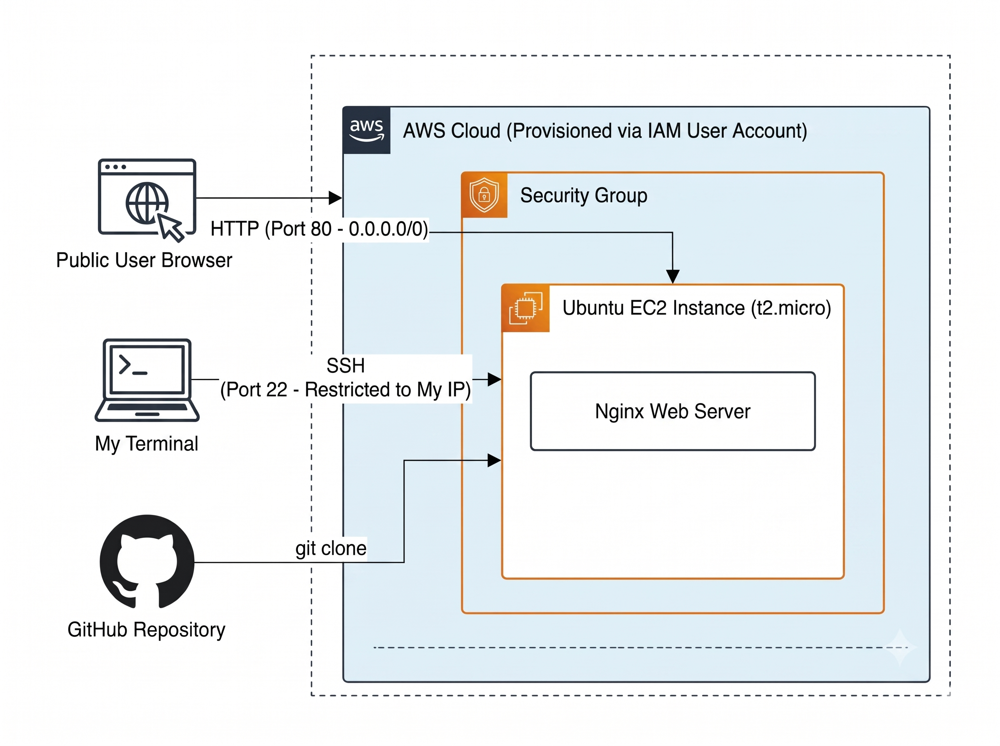

# AWS Zero to Hero Series Project 1 ( lec1 - lec3)

A  static web portal deployed on **Amazon EC2 (Ubuntu)** using **Nginx** and a **Git**

##  Architecture Diagram

##  Steps

* Provisioned infrastructure using a dedicated non-root IAM User account.
* Configured inbound rules to allow public HTTP traffic (`Port 80 - 0.0.0.0/0`) while restricting SSH access (`Port 22`) strictly to my IP address.
*  Cloned the structured HTML/CSS/JS repository directly from GitHub onto the Ubuntu EC2 (`t2.micro`) instance.
*  Served static assets via **Nginx** 

## Tech Stack
* **Cloud:** AWS (IAM, EC2, Security Groups)
* **OS & Web Server:** Ubuntu Linux, Nginx
* **Version Control:** Git & GitHub
* **Frontend:** HTML5, CSS3, JavaScript
